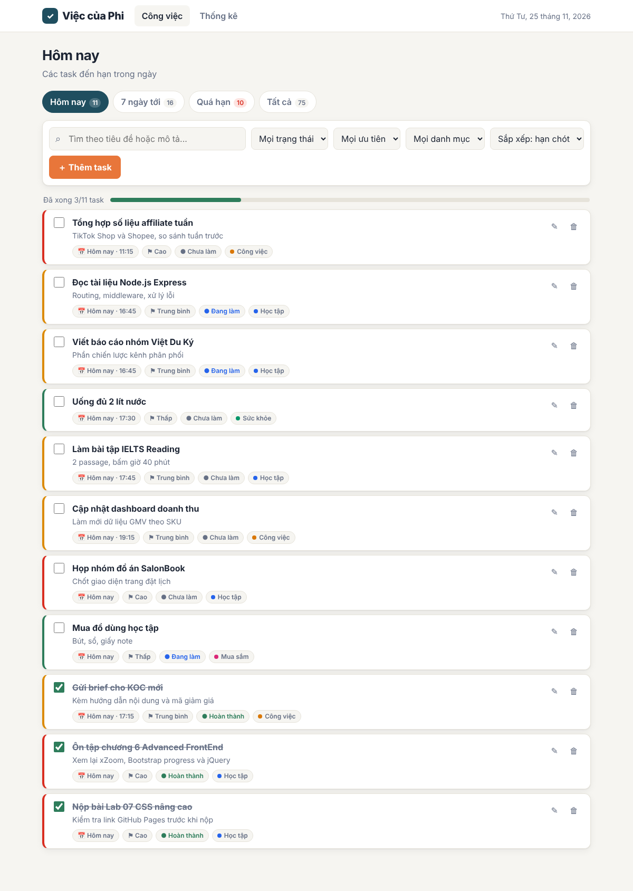
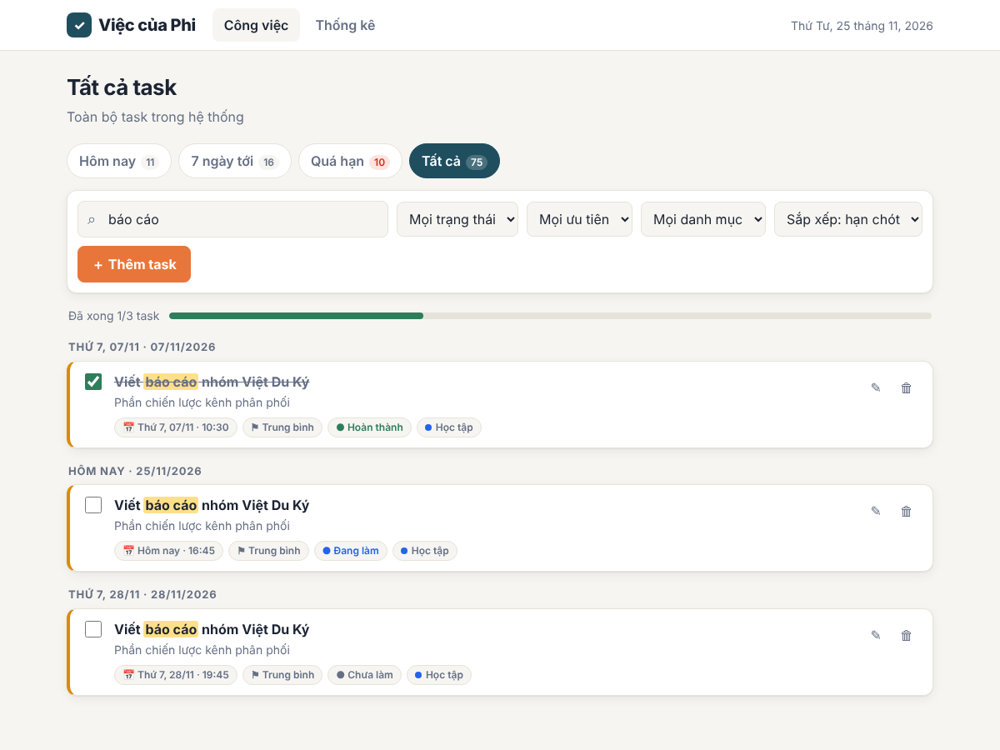
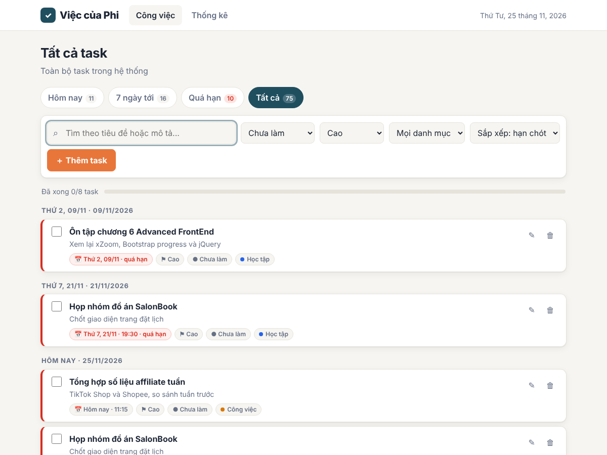
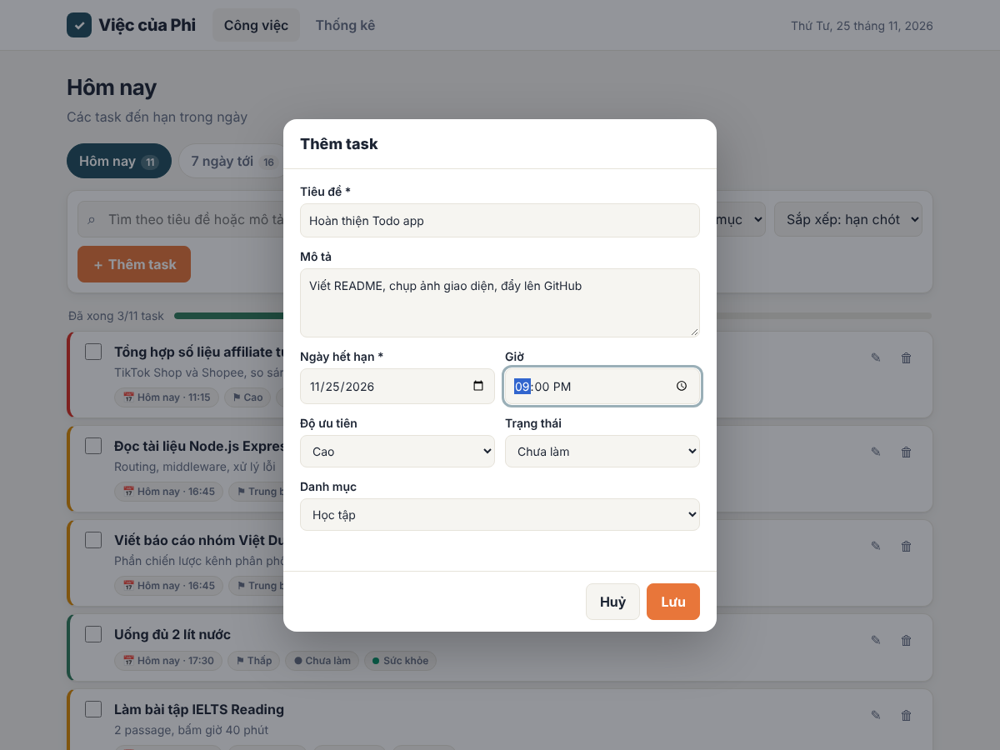
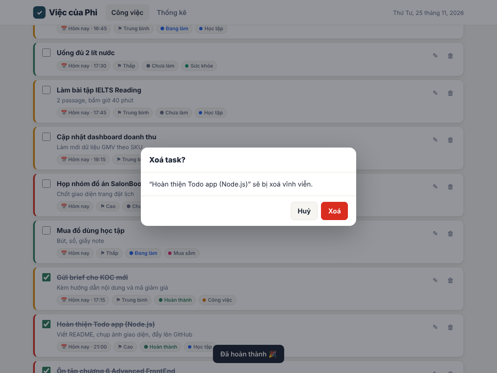
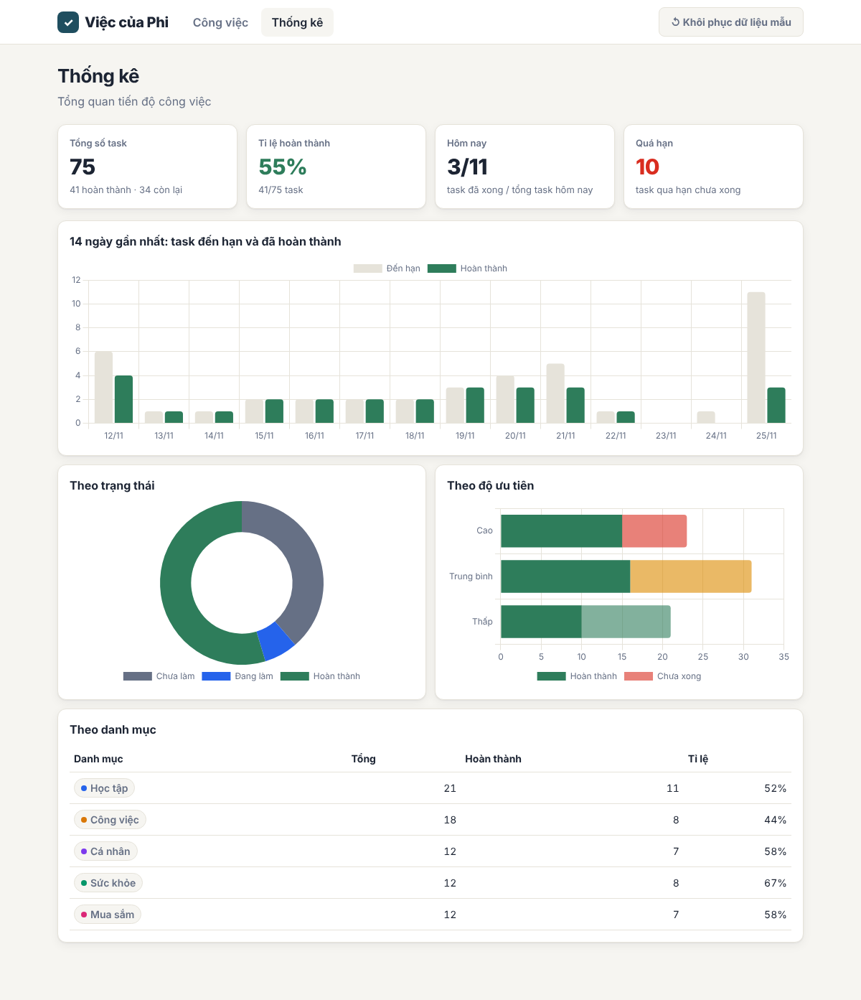
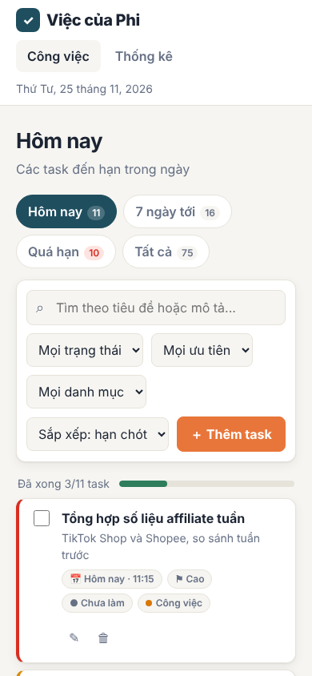
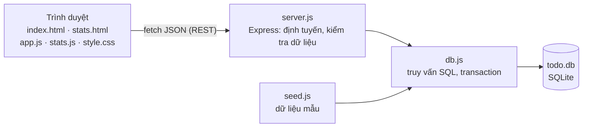
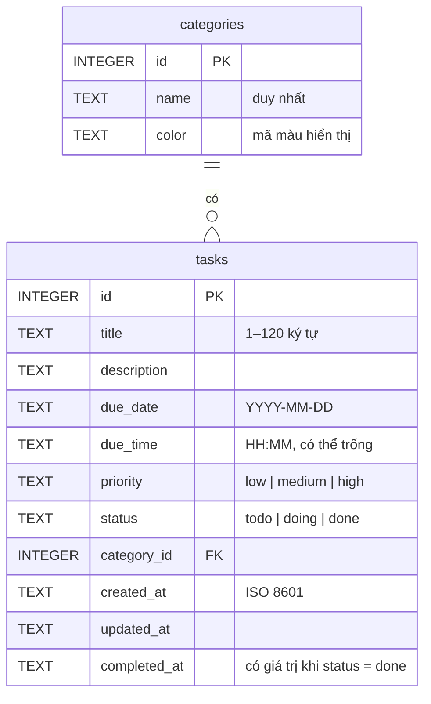

# ✓ Việc của Phi – Todo app quản lý task cá nhân

Ứng dụng web quản lý công việc cá nhân, viết bằng **Node.js + Express**, lưu dữ liệu bằng **SQLite**.

**Sinh viên:** Nguyễn Nhật Phi · **MSSV:** 31241025042 · **Lớp học phần:** 26C1INF50902701



---

## 1. Chức năng

### 1.1 Hiển thị task hôm nay, tìm kiếm, lọc
- Trang chủ mở sẵn tab **Hôm nay**: các task đến hạn trong ngày, kèm thanh tiến độ "Đã xong x/y task".
- Các tab khác: **7 ngày tới**, **Quá hạn** (qua hạn mà chưa xong), **Tất cả**. Mỗi tab hiện số lượng task.
- **Tìm kiếm** theo tiêu đề hoặc mô tả, kết quả tự cập nhật khi gõ và tô sáng từ khoá.
- **Lọc** theo trạng thái (chưa làm / đang làm / hoàn thành), độ ưu tiên (cao / trung bình / thấp), danh mục.
- **Sắp xếp** theo hạn chót, độ ưu tiên hoặc mới tạo. Task quá hạn có nhãn đỏ.

| Tìm kiếm | Lọc |
|---|---|
|  |  |

### 1.2 Thêm, sửa, xoá
- **Thêm:** nút "＋ Thêm task" (hoặc phím `N`), nhập tiêu đề, mô tả, ngày, giờ, ưu tiên, trạng thái, danh mục.
- **Sửa:** nút ✎ trên từng task, mở lại form với dữ liệu cũ.
- **Đánh dấu hoàn thành nhanh:** tick vào ô vuông đầu task.
- **Xoá:** nút 🗑, có hộp thoại xác nhận trước khi xoá.
- Kiểm tra dữ liệu ở cả trình duyệt và server: tiêu đề bắt buộc, tối đa 120 ký tự, ngày đúng định dạng, ưu tiên/trạng thái hợp lệ.

| Thêm task | Xác nhận xoá |
|---|---|
|  |  |

### 1.3 Trang thống kê (có dữ liệu mẫu)
- 4 chỉ số: tổng task, tỉ lệ hoàn thành, tiến độ hôm nay, số task quá hạn.
- Biểu đồ 14 ngày gần nhất (task đến hạn và đã hoàn thành), biểu đồ theo trạng thái, theo độ ưu tiên, bảng theo danh mục.
- **Dữ liệu mẫu:** 75 task thuộc 5 danh mục, trải từ 21 ngày trước đến 7 ngày tới, tự tạo khi chạy lần đầu. Nút **"↺ Khôi phục dữ liệu mẫu"** để tạo lại.



Giao diện co giãn theo màn hình điện thoại và tự đổi sang nền tối nếu máy đang dùng chế độ tối.



---

## 2. Cách chạy

**Yêu cầu:** Node.js 18 trở lên ([tải tại nodejs.org](https://nodejs.org)). Không cần cài database server.

```bash
cd todo-app     # mã nguồn nằm trong thư mục todo-app
npm install      # cài thư viện
npm start        # chạy server
```

Mở trình duyệt tại **http://localhost:3000**. Lần chạy đầu, file `todo.db` được tạo cùng 75 task mẫu.

| Lệnh | Tác dụng |
|---|---|
| `npm start` | Chạy ứng dụng ở cổng 3000 (đổi cổng: `PORT=4000 npm start`) |
| `npm run seed` | Xoá dữ liệu và tạo lại 75 task mẫu |
| `npm test` | Chạy 8 bài kiểm thử API tự động (dùng CSDL tạm, không ảnh hưởng dữ liệu thật) |

---

## 3. Kiến trúc hệ thống



- **Giao diện (frontend):** HTML, CSS, JavaScript thuần; biểu đồ dùng Chart.js. Giao diện gọi API bằng `fetch` và vẽ lại danh sách, không tải lại trang.
- **Máy chủ (backend):** Express cung cấp REST API và phục vụ các file giao diện. Server chỉ trả đúng 5 file giao diện, không cho tải `server.js` hay `todo.db`.
- **Dữ liệu:** SQLite qua thư viện **sql.js** (SQLite biên dịch sang WebAssembly). Lý do chọn: dữ liệu gọn trong 1 file, không phải cài và cấu hình database server, và không cần công cụ biên dịch nên `npm install` chạy được trên Windows, macOS, Linux.

### 3.1 Cơ sở dữ liệu



- Ràng buộc `CHECK` bảo đảm độ dài tiêu đề, giá trị `priority` và `status` hợp lệ ngay ở tầng database.
- Khoá ngoại `category_id` dùng `ON DELETE SET NULL`: xoá danh mục thì task vẫn còn.
- Chỉ mục trên `due_date`, `status`, `category_id` để lọc theo ngày, trạng thái, danh mục nhanh.
- `completed_at` tự ghi khi task chuyển sang hoàn thành và xoá khi chuyển ngược lại, phục vụ thống kê.
- Mọi thao tác ghi chạy trong transaction, thành công mới lưu xuống file `todo.db`.

### 3.2 REST API

| Phương thức | Đường dẫn | Chức năng |
|---|---|---|
| GET | `/api/tasks?view=&q=&status=&priority=&category_id=&sort=` | Danh sách task. `view`: `today` \| `upcoming` \| `overdue` \| `all` |
| GET | `/api/tasks/counts` | Số task theo từng tab |
| GET | `/api/tasks/:id` | Chi tiết 1 task |
| POST | `/api/tasks` | Thêm task |
| PUT | `/api/tasks/:id` | Sửa task (gửi các trường cần đổi) |
| PATCH | `/api/tasks/:id/toggle` | Đổi qua lại hoàn thành / chưa làm |
| DELETE | `/api/tasks/:id` | Xoá task |
| GET | `/api/categories` | Danh mục kèm số task |
| GET | `/api/stats` | Số liệu cho trang thống kê |
| POST | `/api/reset` | Tạo lại dữ liệu mẫu |

Ví dụ thêm task:
```bash
curl -X POST http://localhost:3000/api/tasks -H "Content-Type: application/json" \
  -d '{"title":"Ôn thi cuối kỳ","due_date":"2026-12-01","priority":"high","category_id":1}'
```

---

## 4. Cấu trúc thư mục

Toàn bộ mã nguồn nằm chung trong thư mục [`todo-app/`](todo-app):

| File | Vai trò |
|---|---|
| `server.js` | Express server, REST API, kiểm tra dữ liệu |
| `db.js` | Kết nối SQLite (sql.js), lược đồ bảng, hàm truy vấn và transaction |
| `seed.js` | Sinh 75 task mẫu |
| `dates.js` | Xử lý ngày theo giờ địa phương |
| `index.html`, `app.js` | Trang Công việc |
| `stats.html`, `stats.js` | Trang Thống kê |
| `style.css` | Giao diện chung |
| `test.js` | Kiểm thử API |
| `PROMPTS.md` | Các prompt đã dùng để vibe code |
| `screenshot-*.png` | Ảnh chụp giao diện |

---

## 5. Prompt vibe code

Ứng dụng được xây dựng bằng cách mô tả yêu cầu cho AI (Claude) và kiểm tra, chỉnh sửa qua từng vòng. Toàn bộ prompt và quyết định ở mỗi bước có trong [PROMPTS.md](todo-app/PROMPTS.md).

